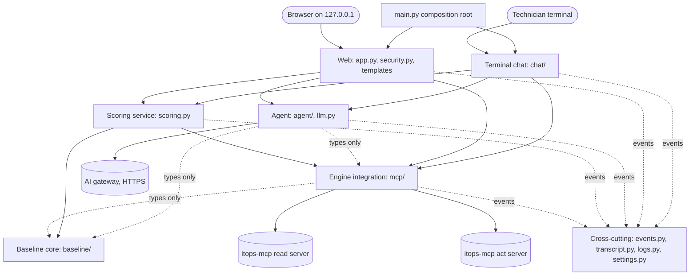

# Application Design: itops-console

**Stage**: INCEPTION - Application Design
**Depth**: Standard
**Created**: 2026-11-24
**Plan**: `aidlc-docs/inception/plans/application-design-plan.md` (Q1 to Q9 = A, approved 2026-11-24)
**Inputs**: `requirements.md`, `stories.md`, `personas.md`, `execution-plan.md`, `docs/tech-env.md`

This document consolidates the four design documents in this folder:

| Document | Contents |
|---|---|
| `components.md` | 31 components (C1 to C31): purpose, responsibilities, interface, web routes |
| `component-methods.md` | Method signatures and types per component (business rules wait for Functional Design) |
| `services.md` | Eight services (S1 to S8) and their orchestration, with sequence diagrams |
| `component-dependency.md` | Dependency matrix, import-boundary rules B1 to B9, communication patterns, data flows |

---

## 1. Design decisions

| Q | Decision | Effect on the design |
|---|---|---|
| Q1 = A | Keep the `tech-env.md` structure; add missing modules; no renaming | 16 modules added (marked new in `components.md`); none renamed |
| Q2 = A | An evidence adapter converts engine evidence to console types | `mcp/evidence.py` (C8) is the only module that knows engine evidence shapes; a template change stops there |
| Q3 = A | Frozen dataclasses in the baseline core; pydantic at the boundaries | `baseline/` is pure and strictly typed; pydantic in policy parsing, settings, engine responses, forms |
| Q4 = A | The model gets read tools and `plan_remediation`; only a technician-typed command executes | The tool registry (C13) has no execute tool; only the chat session (C17) calls `ActGuard.execute` |
| Q5 = A | A fixed read-tool allowlist in console code | `READ_TOOL_ALLOWLIST` in C13; new engine tools are not offered until added |
| Q6 = A | The console cross-checks the act server at run time | `mcp/act_guard.py` (C10), separate from the approval store, flags an execution without an accepted answer |
| Q7 = A | A chat session service orchestrates one session | C17 resolves, scores, runs the agent, routes execution and owns the transcript; the agent loop (C14) only runs turns and tools |
| Q8 = A | One composition root; no module-level singletons | `main.py` (C30) builds and wires everything; tests build their own with fakes |
| Q9 = A | One session event type fanned out by a dispatcher | `events.py` (C27) sends each event to transcript, log and terminal, in that order |

---

## 2. Architecture at a glance

One async Python process on the laptop holds every component. It talks to
the itops-mcp read and act servers on loopback, to the AI gateway over HTTPS,
to the technician through the terminal, and to a browser on `127.0.0.1`.



Text alternative:

```
Entry points: the technician's terminal -> Terminal chat;
              the browser on 127.0.0.1 -> Web.
main.py builds everything and starts Terminal chat and Web.
Terminal chat -> Scoring service, Agent, Engine integration.
Web           -> Engine integration (approval answers),
                 Scoring service (fleet), Agent (narrative).
Agent         -> AI gateway (HTTPS); uses Engine and Core types only.
Scoring       -> Engine integration and Baseline core.
Engine        -> itops-mcp read server and act server (loopback);
                 uses Core types only (evidence adapter).
Baseline core -> nothing.
Every group except Core emits events to Cross-cutting.
```

---

## 3. Components

| Group | Components | Key responsibility |
|---|---|---|
| Baseline core `baseline/` | C1 core types, C2 policy parser, C3 check rules, C4 device scoring and status, C5 fleet computation | Pure, deterministic scoring; no I/O, no clock, no model |
| Engine integration `mcp/`, `scoring.py` | C6 read client, C7 act client, C8 evidence adapter, C9 approval store, C10 act guard, C11 scoring service | The only connections to the engine; the two approval layers; fetch, adapt and score |
| Agent `llm.py`, `agent/` | C12 LLM client, C13 tool registry, C14 agent loop, C15 prompts, C16 fleet narrative writer | Hand-written tool loop with limits; the model reads and plans, never executes |
| Terminal chat `chat/` | C17 chat session service, C18 device identity resolver, C19 terminal command loop, C20 terminal printer | One session at a time; code resolves devices; all output through events |
| Web `app.py`, `security.py`, `templates/` | C21 app factory and routes, C22 request security, C23 approval page, C24 fleet page, C25 transcript viewer | Session, origin, CSRF, headers; full-plan approval page; read-only viewer |
| Cross-cutting | C26 settings, C27 events and dispatcher, C28 transcript store, C29 logging and alerts, C30 composition root | Validated settings; one event fan-out; append-only records; wiring |
| Outside the package | C31 scenario suite runner | Ten approved scenarios, graded, results per model and date |

Full definitions: `components.md`. Signatures: `component-methods.md`.

## 4. Services

| Service | Summary |
|---|---|
| S1 Startup and shutdown | Settings, logging, policy, HTMX hash, build, connect, launch link, serve; shutdown cancels open approvals first |
| S2 Chat session | Identify, score immediately, then ask; execute only by technician command |
| S3 Scoring | Fetch, adapt, score with the real current time; one device or the fleet; errors never pass |
| S4 Remediation and approval | Plan (model), execute (technician), elicitation to the approval page, answer once, server acts, run-time cross-check, report |
| S5 Fleet summary | Code-computed rankings; narrative only on request, labeled |
| S6 Transcript review | Read-only list and view; session IDs checked before any file read |
| S7 Event dispatch | Redact, then transcript, log, terminal; a failed transcript write stops the session |
| S8 Web request security | Loopback bind, body cap, session, origin and CSRF, validation, object check, headers, generic errors |

Full orchestration and diagrams: `services.md`.

---

## 5. FR-APR-8: the two approval layers in separate modules (plan step 12a)

The stakeholder asked whether approval is enforced in the harness or at the
server. The answer is both, and each layer lives in its own module so each
can be shown refusing on its own.

| Layer | What enforces it | Console module | How it is shown refusing on its own |
|---|---|---|---|
| **Server** | The itops-mcp act server will not execute without an accepted elicitation answer and writes its audit row first | Engine (external), checked at run time by the act guard `mcp/act_guard.py` (C10, Q6 = A) | A fake act server that executes without an accepted answer: the act guard reports a violation, raises a security alert and reports nothing as successful |
| **Harness** | The console has no path that answers an approval except a person on the approval page; every automatic answer is a decline | Approval store `mcp/approvals.py` (C9), answered only from the approval route in `app.py` | A recording fake act server sees zero accepted answers on decline, cancel, close, timeout, replay, schema mismatch and unexpected elicitation; import-boundary test B3; a control test with the approval check removed must fail (NFR-Q-6) |

The act guard receives the approval store only through a narrow interface
(`expect` and `ledger`) that has no answering method, so the server-layer
check cannot become a second way to approve.

**Defense in depth around one execution** (SECURITY-11):

1. The model has no execute tool (C13, rule B4).
2. Only a technician-typed command reaches `ActGuard.execute` (C17, rule B5).
3. The execute command accepts only a plan created in this session (C17).
4. The approval page needs this launch's session, a same-origin POST and a
   CSRF token (C22).
5. An approval is answered once, and only while open (C9).
6. Elicitations that do not match the schema, or are for a plan no session
   is executing, are declined automatically (C9).
7. The act server requires an accepted answer and writes its audit row first
   (engine).
8. The act guard cross-checks every execution against the approval ledger
   (C10).
9. Every remediation runs on the engine's no-op demo runner; the guard
   alerts on any other runner (FR-REM-3).
10. The transcript and the engine's audit log record every step (C28, engine).

---

## 6. Security design (plan step 12b)

### 6.1 Security-critical modules (SECURITY-11, SEC-REQ-14)

| Module | Security role |
|---|---|
| `baseline/` (C1 to C5) | Pass or fail is computed by code, never by the model (LLM09) |
| `mcp/approvals.py` (C9) | Harness approval layer: the only resolver of approvals |
| `mcp/act_guard.py` (C10) | Run-time check of the server approval layer and the demo runner |
| `security.py` (C22) | Launch session, origin, CSRF, headers, body cap, generic errors, HTMX integrity |
| `agent/tools.py` (C13) | The model's capability boundary: allowlisted reads and planning only (LLM06) |
| `events.py`, `logs.py` (C27, C29) | Redaction of secrets; security alerts |

### 6.2 Misuse cases mapped to components

MS-1 to MS-6 come from `stories.md` (epic E6). MS-7 to MS-9 were identified
during this design; they add tests but change no story or requirement.

| Misuse case | Controls | Components |
|---|---|---|
| MS-1 A malicious web page posts an approval | Session cookie (`SameSite=Strict`), origin check, CSRF token, security alert, zero executions | C22, C21, C9, C27 |
| MS-2 Another local process opens the approval page | Bind to `127.0.0.1`; every route except `/health` and `/start` needs this launch's session; launch token never logged; lockout after repeated failed exchanges | C30, C22 |
| MS-3 Replaying an approval | Answer only an open approval, once; `ApprovalNotOpen` is a security alert | C9, C22 |
| MS-4 Prompt injection through device data | Tool output labeled as data in prompts; no execute tool; every action needs a person on the page; scoring never uses the model; output escaped in pages and sanitized in the terminal | C15, C13, C9, C3, C4, C20, C23 |
| MS-5 A tampered policy file | `yaml.safe_load` on text; pydantic model with forbidden extra keys and bounded values; startup stops with the reason | C2, C30 |
| MS-6 Fishing for secrets | Secrets as `SecretStr`, held only by the clients that send them; redaction in the event bus and the log filter; no secrets in prompts; launch token leaves the address bar by redirect; generic error pages | C26, C27, C29, C15, C22 |
| MS-7 A misbehaving or compromised act server executes without an accepted answer, sends an elicitation the console did not expect, or names a real runner | Run-time ledger cross-check, automatic decline of unexpected elicitations, demo-runner check, security alerts | C10, C9 |
| MS-8 Terminal control sequences in device data or model text rewrite the technician's screen | `sanitize` strips control characters and escape sequences before printing | C20 |
| MS-9 Path traversal through the transcript viewer's session ID | Fixed ID format and a check that the resolved path stays inside the transcript directory | C28, C25 |

### 6.3 Security requirements mapped to components

| Requirement | Components |
|---|---|
| SEC-REQ-1 loopback bind, limited outbound | C30 (bind), C26 (engine URLs loopback, gateway `https`) |
| SEC-REQ-2 per-launch token and session cookie | C22, C30 |
| SEC-REQ-3 origin and CSRF on every POST | C22 |
| SEC-REQ-4 answer once, only open | C9 |
| SEC-REQ-5 security headers, CSP | C22 |
| SEC-REQ-6 validation with limits, body cap, autoescape | C21, C22, C13, C26, C2, C23 to C25 |
| SEC-REQ-7 docs off, generic errors, no defaults | C21, C22 |
| SEC-REQ-8 supply chain | Build and CI (Code Generation, Build and Test); no component |
| SEC-REQ-9 safe parsing, HTMX hash, no CDN | C2, C22, rule B9 |
| SEC-REQ-10 structured logs, no secrets | C29, C27 |
| SEC-REQ-11 security events and alerts, append-only | C27, C29, C20, C28, rule B8 |
| SEC-REQ-12 fail closed, global error handler | C22, C9, C10, C11, S7 |
| SEC-REQ-13 encryption, TLS | C26 (`https` gateway), README (full-disk encryption) |
| SEC-REQ-14 dedicated security modules, misuse cases | Section 6.1, 6.2 |
| SEC-REQ-15 OWASP LLM controls | C13, C15, C9, C20 |

---

## 7. Traceability (plan step 12c)

### 7.1 Functional requirements to components

| Requirement | Components |
|---|---|
| FR-POL-1 to FR-POL-3 | C2, C30 |
| FR-SCOPE-1, FR-SCOPE-2 | C4, C6, C11 |
| FR-CLS-1 to FR-CLS-4 | C4, C3, C2 |
| FR-RULE-0a to FR-RULE-0e, FR-RULE-1 to FR-RULE-8 | C3, C1 |
| FR-CERT-1 to FR-CERT-4 | C4 |
| FR-CHAT-1 | C19, C20 |
| FR-DEV-1, FR-DEV-2 | C18, C6, C17 |
| FR-DEV-3 | C17, C11, C8, C15 |
| FR-AGT-1 | C13, C14, C6 |
| FR-AGT-2 | C27, C20, C28, C14 |
| FR-AGT-3, FR-AGT-4 | C15, C14 (measured by C31) |
| FR-AGT-5 | C14, C26 |
| FR-AGT-6 | C14, C12 |
| FR-REM-1, FR-REM-2 | C13, C10, C7, C17 |
| FR-REM-3 | C10, C23, C20 |
| FR-APR-1, FR-APR-3, FR-APR-4, FR-APR-7 | C23, C21, C9 |
| FR-APR-2 | C9 |
| FR-APR-5 | C9, C30 (shutdown) |
| FR-APR-6 | C9, C27, C20 |
| FR-APR-8 | C9, C10 (section 5) |
| FR-EXE-1 | C10, C17, C20, C28 |
| FR-FLT-1 to FR-FLT-4 | C5, C11, C24 |
| FR-FLT-5 | C16, C24 |
| FR-FLT-6 | C5, C16, C24 droppable together |
| FR-TRN-1, FR-TRN-3 | C28, C27 |
| FR-TRN-2 | C25, C28 |
| FR-LLM-1 | C12, C26 |
| FR-LLM-2 | C31, C26 |
| FR-LLM-3 | C12, C17, S1 (no gateway call at startup) |
| FR-DEMO-1 | Engine (external); console tests use recorded fixture responses |
| FR-DEMO-2 | Engine (external); C11 scores with the real clock |
| FR-TOK-1 | C26, C6, C7 |
| FR-EVAL-1, FR-EVAL-2 | C31 |

### 7.2 Stories to components

| Story | Components |
|---|---|
| US-1.1 Identify a device | C18, C19, C17, C6 |
| US-1.2 Scoring runs as soon as the device is known | C17, C11, C8, C4, C15, C27, C28 |
| US-1.3 Only active devices are scored | C4, C11, C6 |
| US-1.4 Device class decides what is scored | C4, C3, C2 |
| US-1.5 to US-1.9 Check results | C3, C1 |
| US-1.10 Overall device status | C4 |
| US-1.11 Explanation with evidence | C14, C13, C15, C20, C28 |
| US-1.12 Recommendation from the catalog | C15, C13, C14 |
| US-1.13 Bounded agent and model outages | C14, C12, C17, C26 |
| US-2.1 Plan the endpoint protection reinstall | C13, C10, C7, C17 |
| US-2.2 Read the whole plan on the approval page | C9, C23, C20, C22 |
| US-2.3 Approve and see the result | C23, C9, C10, C17, C20 |
| US-2.4 Anything but approval means nothing runs | C9, C10, C30 |
| US-2.5 Unexpected approval forms are refused | C9 |
| US-3.1 Gaps ranked by check | C5, C11, C24 |
| US-3.2 Remote fixes ranked by devices certified | C5, C11, C24 |
| US-3.3 Devices that need something other than a fix | C5, C4, C24 |
| US-3.4 Narrative on request | C16, C24 |
| US-4.1 Browse past sessions | C25, C28 |
| US-4.2 Complete, append-only records | C28, C27 |
| US-5.1 Clean clone to working demo | C26, C30, C6, C7 (README in Construction) |
| US-5.2 Open the web pages from the terminal | C22, C30 |
| US-5.3 A demo fleet that never goes stale | Engine (external), C11 |
| US-5.4 Change a threshold without a release | C2, C30 |
| US-5.5 Run the scenario suite | C31 |
| US-5.6 Model and limits configured, not coded | C26 |
| MS-1 to MS-6 | Section 6.2 |

---

## 8. Validation (plan step 13)

| Check | Result |
|---|---|
| Every functional requirement maps to a component | Yes (7.1). FR-DEMO-1 and FR-DEMO-2 are engine work (Q14 = A); the console's side is covered by C11 and recorded responses |
| Every story maps to a component | Yes (7.2): 30 user stories, 6 misuse stories |
| Every security requirement maps to a component or a build step | Yes (6.3) |
| No dependency cycles | Yes. Group matrix ordered Core, Cross-cutting, Engine, Scoring, Agent, Chat, Web, Composition root. One module cycle found during drafting (the evidence adapter needed `DeviceSummary` from `mcp/clients.py`, which imports the adapter) and removed by moving that conversion to the scoring service |
| The baseline core imports no I/O | Yes. The policy file is read by C30 and parsed as text by C2; `now` is a parameter; rule B1 makes it a test |
| FR-APR-8 layers in separate modules | Yes: `mcp/approvals.py` and `mcp/act_guard.py` (section 5) |
| Fleet summary droppable (FR-FLT-6) | Yes: C5, C16, C24, `score_fleet` and two routes; nothing else imports them |
| Mermaid diagrams | Four diagrams checked by hand: alphanumeric node and participant IDs, quoted labels, no semicolons or unescaped quotes, no reserved word `end` in labels; each has a text alternative |
| ASCII content | Text data flows use plain ASCII arrows only; no box diagrams |

---

## 9. Open items carried forward

| # | Item | Decided in |
|---|---|---|
| 1 | The read-tool allowlist's exact names (C13), from the recorded engine contract | Functional Design (agent) |
| 2 | Where the remediation catalog and the checks each entry fixes come from (`CatalogSource`, FR-FLT-3): an engine catalog tool or a section of the policy file | Functional Design (baseline core) |
| 3 | Loading `.env`: `pydantic-settings` (a new dependency, so SECURITY-10 applies) or a small standard-library parser | NFR Requirements |
| 4 | Whether target browsers accept a `Secure` cookie on `127.0.0.1` (SEC-REQ-2) | NFR Requirements |
| 5 | The fastmcp 4 elicitation handler signature and answer type, and that the handler can await a person for minutes | Early in Construction (requirements risk) |
| 6 | How scenario answers are graded for cause and fix (C31) | Functional Design (scenario suite) |
| 7 | Launch token rules: single use or reusable during the run, session lifetime, failed-exchange limit | NFR Design |
| 8 | Engine contract: the approval schema should carry the runner identity, so a non-demo runner fails schema validation; execution results should carry plan ID, runner and audit reference | Engine repository |
| 9 | Engine unreachable at startup: stop (this design) or start with chat disabled | Functional Design |
| 10 | Terminal command syntax | Functional Design (terminal chat) |

## 10. Items for the user's review

These choices were made in this design rather than by a question.

1. **Automatic declines** cover more than FR-APR-2's schema mismatch: an
   elicitation for a plan that no session is executing is also declined. If
   the engine adds the runner field (open item 8), a non-demo runner becomes a
   schema mismatch. Every automatic answer is still a decline.
2. **One answering method**: `ApprovalStore.answer()` replaces the
   `tech-env.md` example's `pending.validate()` and `pending.accept()`.
3. **The policy parser takes text**; the composition root reads the file, so
   `baseline/` does no I/O at all.
4. **Launch token lockout** after repeated failed exchanges (SECURITY-12);
   recovering means restarting the console.
5. **A failed transcript write stops the session** (fail closed).
6. **Terminal output is sanitized** of control characters (MS-8).
7. **Approval page has no JavaScript**; HTMX is used only on the fleet page.
8. **New optional settings**: `WEB_PORT` (default 8080), `TRANSCRIPT_DIR`,
   `LOG_DIR`. The web host is fixed at `127.0.0.1`, not a setting.

---

## 11. Extension compliance (plan step 14)

### Security Baseline (enabled)

| Rule | Status | Rationale |
|---|---|---|
| SECURITY-01 Encryption at rest and in transit | Compliant (adapted) | Local files only, on a full-disk-encrypted laptop (SEC-REQ-13); gateway over HTTPS enforced by settings validation; loopback HTTP to the engine is the documented exception |
| SECURITY-02 Access logging on intermediaries | N/A | No load balancer, API gateway or CDN; the university gateway is not part of this product |
| SECURITY-03 Application-level logging | Compliant | C29: JSON lines with timestamp, session or request ID, level, message; one local store; redaction filter; events redacted at the bus |
| SECURITY-04 HTTP security headers | Compliant, documented exception | C22 sets CSP, nosniff, frame DENY, referrer policy on every HTML response; HSTS omitted on plain-HTTP loopback (SEC-REQ-5) |
| SECURITY-05 Input validation | Compliant | Pydantic with explicit limits on every route, form, setting, policy and tool argument; body cap; ID format checks; autoescape; no SQL or OS commands exist |
| SECURITY-06 Least privilege | N/A | No IAM policies or roles. In the same spirit, the read token is held only by the read client and the act token only by the act client |
| SECURITY-07 Restrictive network configuration | Compliant (adapted) | Bind to `127.0.0.1`; outbound only to loopback engine URLs and the `https` gateway, enforced in settings |
| SECURITY-08 Application-level access control | Compliant | Deny by default (session on every route except `/health` and `/start`); object-level checks for approvals (open only) and transcripts (ID format, path containment); no CORS; session validated server-side on every request |
| SECURITY-09 Hardening | Compliant | Docs routes off; generic error pages; no default credentials; no directory listing; no sample pages |
| SECURITY-10 Supply chain | N/A at this stage | The design adds no dependency. Lock file, pip-audit, SBOM and pinned Actions are built in Code Generation (SEC-REQ-8). Open item 3 must keep any new dependency under these controls |
| SECURITY-11 Secure design | Compliant | Dedicated security modules (6.1); defense in depth around execution (section 5); misuse cases MS-1 to MS-9 (6.2). Rate limiting: no public-facing endpoint (loopback only); the launch-token lockout covers brute force |
| SECURITY-12 Authentication and credentials | Compliant (adapted) | No accounts or passwords, so password policy, hashing and MFA are N/A. Session cookie `HttpOnly`, `SameSite=Strict`, `Secure` (browser support verified in NFR Requirements, open item 4); sessions end when the console stops; launch-token lockout; secrets only in `.env` as `SecretStr` |
| SECURITY-13 Integrity | Compliant | `yaml.safe_load` and JSON only, no pickle (B9); no CDN; HTMX hash check at startup; append-only transcripts plus the engine's audit log record who did what and when. CI pipeline controls carried to Code Generation |
| SECURITY-14 Alerting and monitoring | Compliant (adapted) | Security alerts for every refusal, printed in the terminal and logged at WARNING (the alarm configuration for a single-user local tool); application cannot rewrite logs or transcripts (B8); retention of at least 90 days |
| SECURITY-15 Exception handling | Compliant | Fail closed in S2 to S4 and S7; global error handler; resources closed in `try/finally` at shutdown |

No blocking security findings.

### Property-Based Testing (Partial: PBT-02, 03, 07, 08, 09 enforced)

| Rule | Status | Rationale |
|---|---|---|
| PBT-02 Round-trip | Compliant | Round-trip points identified: transcript `to_line` and `from_line` (C28); policy `parse_policy` and `dump_policy` (C2) |
| PBT-03 Invariants | Compliant | Invariant points identified: outcomes always in the allowed set (C3); non-certified classes never certified and never scored on screen lock, and any `fail`, `no_data` or `stale` blocks certification (C4); moving a report date into the past never turns `stale` into `pass` (C3); fleet counts never exceed in-scope devices (C5); `decide` never selects when there are several candidates (C18); `sanitize` output has no control characters (C20) |
| PBT-07 Generator quality | N/A at this stage | Test code; shared domain generators go in one test module (TST-PBT-4) |
| PBT-08 Shrinking and reproducibility | N/A at this stage | Test configuration; carried to Code Generation |
| PBT-09 Framework | Compliant | Hypothesis (TST-PBT-1) |
| PBT-01, 04, 05, 06, 10 | Advisory | PBT-01 property lists are written in Functional Design; the approval store is a candidate for a stateful test (PBT-06) |

### Resiliency Baseline

Disabled (Q30 = B); skipped.
