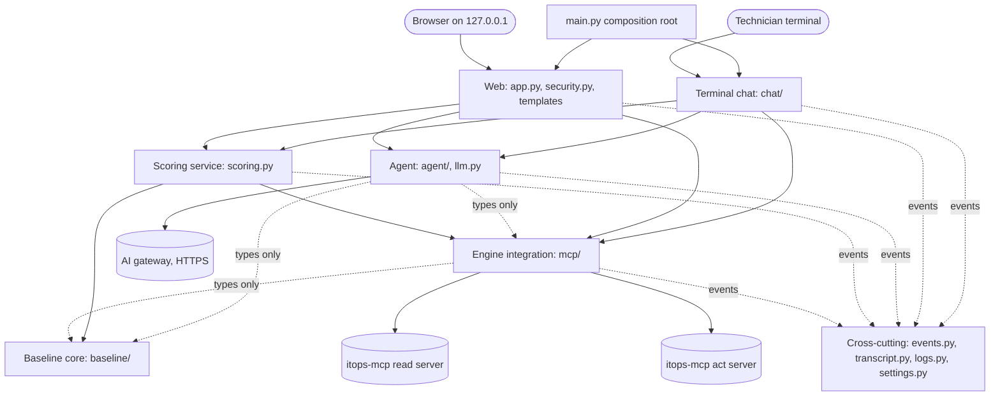

# Component Dependencies: itops-console

**Stage**: INCEPTION - Application Design
**Created**: 2026-11-24
**Companion to**: `components.md`, `services.md`

"A depends on B" means A imports B or calls it. Dependencies point one way,
from the edges of the product (terminal, web) toward the pure core. The
composition root (C30) depends on everything and nothing depends on it.

---

## Group-level dependency matrix

Read across: the row group depends on the column group.

| Row depends on column | Core | Engine | Scoring | Agent | Chat | Web | Cross-cutting |
|---|---|---|---|---|---|---|---|
| **Core** `baseline/` | - | no | no | no | no | no | no |
| **Engine** `mcp/` | types only (C8) | - | no | no | no | no | events |
| **Scoring** `scoring.py` | yes | yes | - | no | no | no | events |
| **Agent** `llm.py`, `agent/` | types only (C15) | types only (C13) | no | - | no | no | events |
| **Chat** `chat/` | types only | yes (C6, C10) | yes | yes | - | no | events |
| **Web** `app.py`, `security.py` | types only (C24) | yes (C9 answer) | yes (fleet) | yes (C16) | no | - | events, transcript reader, settings |
| **Cross-cutting** | no | no | no | no | no | no | events only (C28, C29 implement the sink protocol) |
| **Composition root** `main.py` | yes | yes | yes | yes | yes | yes | yes |

The matrix is acyclic: ordering the groups Core, Cross-cutting, Engine,
Scoring, Agent, Chat, Web, Composition root, every "yes" points to an earlier
group.

## Module-level dependencies

| Component | Depends on (inside the package) | Third-party |
|---|---|---|
| C1 `baseline/models.py` | none | none |
| C2 `baseline/policy.py` | C1 | pydantic, pyyaml |
| C3 `baseline/rules.py` | C1 | none |
| C4 `baseline/certification.py` | C1, C3 | none |
| C5 `baseline/fleet.py` | C1 | none |
| C6, C7 `mcp/clients.py` | C8 (engine evidence model) | fastmcp, pydantic |
| C8 `mcp/evidence.py` | C1 | pydantic |
| C9 `mcp/approvals.py` | C27 | pydantic |
| C10 `mcp/act_guard.py` | C7, C9 (narrow `ApprovalExpectations` view), C27 | none |
| C11 `scoring.py` | C4, C5, C6, C8, C27 | none |
| C12 `llm.py` | none | openai |
| C13 `agent/tools.py` | C6 and C7 result types (`ToolResult`, `RemediationPlan`), C12 types, C27 | pydantic |
| C14 `agent/loop.py` | C12, C13, C15, C27 | none |
| C15 `agent/prompts.py` | C1, C13 types | none |
| C16 `agent/narrative.py` | C12, C15, C27 | none |
| C17 `chat/session.py` | C10, C11, C14, C15, C18, C27 | none |
| C18 `chat/identity.py` | C6 | none |
| C19 `chat/terminal.py` | C17, C27 | none |
| C20 `chat/printer.py` | C27 | none |
| C21 to C25 `app.py`, templates | C9, C11, C16, C22, C26, C27, C28 | fastapi, jinja2 |
| C22 `security.py` | C27 | fastapi |
| C26 `settings.py` | none | pydantic |
| C27 `events.py` | none | none |
| C28 `transcript.py` | C27 | none |
| C29 `logs.py` | C27 | none |
| C30 `main.py` | all of the above | uvicorn |
| C31 `evals/run.py` | C30, C17 | pyyaml |

`httpx` is used underneath by fastmcp and openai; no console module imports
it directly unless Functional Design finds a need.

---

## Import-boundary rules

These rules make the security design checkable. Each becomes an automated
test that scans the package's imports and calls (an architecture test) in
Construction.

| # | Rule | Protects |
|---|---|---|
| B1 | `baseline/` imports only the standard library, pydantic, pyyaml and `baseline` modules, and never calls `open`, the clock or the network | FR-RULE-0a, NFR-Q-1 |
| B2 | Only `llm.py` imports `openai`; only `mcp/clients.py` imports `fastmcp` | FR-AGT-6, SEC-REQ-10 |
| B3 | Only `app.py` calls `ApprovalStore.answer`; only `mcp/approvals.py` resolves a pending approval | FR-APR-8 harness layer |
| B4 | Nothing under `agent/` imports `mcp/act_guard.py` or the `ActClient` class; the tool registry receives only `ReadTools` and `Planner` | Q4 = A, LLM06 |
| B5 | Only `chat/session.py` calls `ActGuard.execute` | Q4 = A |
| B6 | Only `main.py` constructs shared components; no module-level instances | Q8 = A |
| B7 | Only `chat/printer.py` writes to the terminal after startup; no `print` elsewhere in the package | Q9 = A, FR-AGT-2 |
| B8 | Only `transcript.py` opens transcript files, and only in append mode for writing | FR-TRN-3, SEC-REQ-11 |
| B9 | No module imports `pickle`, `shelve`, `requests` or a prohibited framework; YAML only through `yaml.safe_load` | SEC-REQ-9, `tech-env.md` |

---

## Communication patterns

| Between | Pattern | Notes |
|---|---|---|
| Components inside the process | Direct `async` method calls on one event loop | No threads for application logic; terminal input read without blocking the loop |
| Any component to terminal, transcript and log | Event emitted once, fanned out synchronously by the event bus (S7) | Fixed sink order: transcript, log, terminal |
| Read client to read server | MCP over streamable HTTP on `127.0.0.1:8000`, read bearer token | Plain HTTP on loopback (SEC-REQ-13 exception) |
| Act client to act server | MCP over streamable HTTP on `127.0.0.1:8001`, act bearer token | The server sends an elicitation request back during `execute_remediation` |
| Elicitation to approval route | An `asyncio.Future` in the approval store, resolved by the approval route | The only way a person's answer reaches the act server |
| LLM client to gateway | HTTPS, OpenAI-compatible chat completions with tools | The only destination outside the laptop |
| Browser to web app | HTTP on `127.0.0.1:8080`, session cookie, CSRF token on POST | HTMX on the fleet page only |
| Transcript store and logs to disk | Append-only files | Policy and transcripts read from disk only at startup and by the viewer |

---

## Architecture diagram



Text alternative:

```
Entry points: the technician's terminal -> Terminal chat;
              the browser on 127.0.0.1 -> Web.
main.py builds everything and starts Terminal chat and Web.
Terminal chat -> Scoring service, Agent, Engine integration.
Web           -> Engine integration (approval answers),
                 Scoring service (fleet), Agent (narrative).
Agent         -> AI gateway (HTTPS); uses Engine and Core types only.
Scoring       -> Engine integration and Baseline core.
Engine        -> itops-mcp read server and act server (loopback);
                 uses Core types only (evidence adapter).
Baseline core -> nothing.
Every group except Core emits events to Cross-cutting
(events, transcript, logs).
```

---

## Data flows

### Evidence to explanation

```
engine JSON (read server)
  -> EngineEvidence          pydantic, validated          mcp/clients.py, mcp/evidence.py
  -> DeviceEvidence          frozen dataclasses           mcp/evidence.py (adapter)
  -> DeviceReport            pure scoring with "now"      baseline/certification.py, rules.py
  -> SCORING_RESULT event    terminal, transcript, log    events.py
  -> facts message           fixed facts for the model    agent/prompts.py
  -> model turns and tool calls (read tools, plan only)   agent/loop.py, agent/tools.py
  -> explanation and recommendation, every step an event
```

### Approval

```
execute command (technician)
  -> ActGuard.execute -> ApprovalStore.expect -> execute_remediation
  -> elicitation (act server) -> ApprovalRequest validated or auto-declined
  -> PendingApproval (Future) -> APPROVAL_OPENED event -> link in terminal
  -> approval page (session, origin, CSRF) -> ApprovalStore.answer (once)
  -> answer to act server -> audit row -> demo runner if accepted
  -> ExecutionResult -> ledger cross-check -> EXECUTION_RESULT event
```

### Fleet

```
/fleet -> score_fleet: evidence for every in-scope device, inactive list, catalog
  -> adapter -> score_device per device -> summarize_fleet -> FleetSummary
  -> fleet page (numbers only)
  -> on request: narrative_messages(summary) -> one model call, no tools
  -> labeled partial; NARRATIVE_WRITTEN event in its own transcript
```
