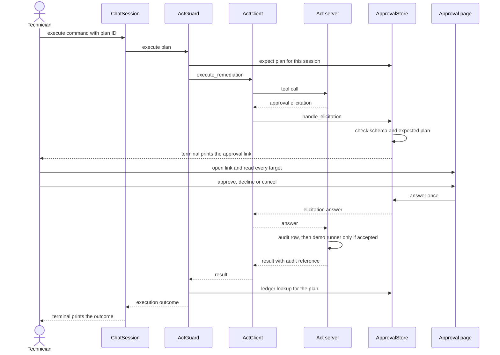

# Services and Orchestration: itops-console

**Stage**: INCEPTION - Application Design
**Created**: 2026-11-24
**Companion to**: `components.md`, `component-methods.md`

A service here is an orchestration of components for one job. All services
run in one process on one asyncio event loop (NFR-P-1), so an open approval
waiting for a person blocks nothing else. Every service reports what it does
through the event bus (Q9 = A) and fails closed on any error (SEC-REQ-12).

| ID | Service | Owner | Used by |
|---|---|---|---|
| S1 | Startup and shutdown | C30 `main.py` | `itops-console` console script |
| S2 | Chat session | C17 `chat/session.py` | C19 terminal command loop, C31 scenario runner |
| S3 | Scoring | C11 `scoring.py` | S2, S5 |
| S4 | Remediation and approval | C17, C10, C9, C21 | Technician (terminal and approval page) |
| S5 | Fleet summary | C11, C5, C16, C21 | Endpoint engineer (fleet page) |
| S6 | Transcript review | C28, C21 | Compliance or team lead (transcript viewer) |
| S7 | Event dispatch | C27 `events.py` | Every service |
| S8 | Web request security | C22 `security.py` | Every web route |

---

## S1 Startup and shutdown

**Startup**, in order. Any failure stops startup with a named reason and no
secret values (US-5.1):

1. Load settings from the environment and `.env` (C26). A missing or invalid
   variable stops startup and is named (FR-TOK-1).
2. Configure logging with redaction of every secret value (C29).
3. Read the policy file and parse it (C2). An invalid or unsafe file stops
   startup with the reason (FR-POL-1, MS-5).
4. Check the vendored HTMX file against its recorded sha256 (C22, SEC-REQ-9).
5. Build every component once and wire them explicitly (Q8 = A): event bus
   with its sinks, transcript store, approval store, read and act clients,
   act guard, scoring service, LLM client, tool registry, agent loop,
   narrative writer, session factory, launch session, web app, terminal loop.
6. Connect the read and act clients. A rejected token or an unreachable
   server stops startup and names which one (FR-TOK-1). The gateway is not
   called at startup, so scoring still works when it is down (FR-LLM-3).
7. Print the launch link (`/start?token=...`) in the terminal (SEC-REQ-2).
8. Run the web server (bound to `127.0.0.1`, SEC-REQ-1) and the terminal
   loop together on the event loop.

**Shutdown** (quit command, end of input, or a signal):

1. Cancel every open approval (closes as cancelled, nothing executes,
   FR-APR-5).
2. End the current chat session (closes its transcript).
3. End the launch session, which invalidates the link and every cookie
   (US-5.2).
4. Stop the web server and close the MCP and LLM clients, each in its own
   `try/finally` so one failure does not skip the rest (SECURITY-15).

---

## S2 Chat session

Owned by the chat session service (Q7 = A). The agent loop only runs model
turns and tool calls.

| Step | Trigger | Orchestration | Events |
|---|---|---|---|
| Start | Terminal loop starts or the previous session ends | New session ID; transcript opened | `SESSION_STARTED` |
| List devices | Technician command | C18 asks the read server for in-scope devices (FR-DEV-1) | `DEVICE_LIST` |
| Identify | Technician picks a number or types text | C18 resolves; pure `decide` gives selected, pick-list or no match (FR-DEV-2) | `DEVICE_SELECTED`, `DEVICE_PICK_LIST` or `DEVICE_NO_MATCH` |
| Score | A device is selected | S3 scores it with the real current time (FR-DEV-3) | `SCORING_STARTED`, `SCORING_RESULT` |
| Ask | Technician types a question | Agent loop runs with the system prompt, the facts message and the session history (FR-AGT-1 to FR-AGT-5) | `MODEL_TURN`, `TOOL_CALL`, `TOOL_RESULT`, `PLAN_CREATED`, `AGENT_STOPPED` |
| Execute | Technician types the execute command with a plan ID | S4 | see S4 |
| End | Quit, new device, or shutdown | Transcript closed | `SESSION_ENDED` |

Rules the orchestration enforces (details in Functional Design):

- The agent loop is never started before a device is scored, so the model
  always receives the fixed results first (US-1.2).
- A model outage ends the agent's turn with `LLM_UNAVAILABLE`; the scoring
  results already printed stay valid (FR-LLM-3).
- `execute` accepts only a plan ID created in this session (by the model's
  `plan_remediation` call), and only from a technician-typed command (Q4 = A).

```mermaid
sequenceDiagram
    actor Tech as Technician
    participant Term as TerminalChat
    participant Sess as ChatSession
    participant Ident as IdentityResolver
    participant Score as ScoringService
    participant Read as ReadClient
    participant Loop as AgentLoop
    participant LLM as LlmClient
    participant Bus as EventBus
    Tech->>Term: names a device
    Term->>Sess: identify text
    Sess->>Ident: resolve text
    Ident->>Read: resolve_device
    Read-->>Ident: candidates
    Ident-->>Sess: selected, pick list or no match
    Sess->>Score: score_device
    Score->>Read: get_evidence
    Read-->>Score: engine evidence
    Score->>Score: adapt, then score with the current time
    Score->>Bus: scoring step and results
    Score-->>Sess: device report
    Tech->>Term: asks a question
    Term->>Sess: ask
    Sess->>Loop: run with facts and history
    loop until answered or a limit is reached
        Loop->>LLM: complete
        LLM-->>Loop: text or tool calls
        Loop->>Bus: model turn, tool call, tool result
    end
    Loop-->>Sess: outcome
    Sess->>Bus: agent stopped with reason
```

Text alternative:

```
1. Technician names a device in the terminal.
2. Terminal loop -> session service: identify(text).
3. Session service -> identity resolver -> read server: resolve_device.
4. Resolver decides: selected, pick-list, or no match.
5. If selected: session service -> scoring service -> read server: get_evidence.
6. Scoring service adapts the evidence, scores it with the current time,
   and emits the scoring step and results.
7. Technician asks a question; session service -> agent loop with the
   facts and the history.
8. Agent loop repeats: model call -> text or tool calls -> events,
   until the model answers or a step or token limit is reached.
9. Session service emits why the agent stopped.
```

---

## S3 Scoring

**One device** (`ScoringService.score_device`):

1. Emit `SCORING_STARTED` (a console-initiated step, FR-DEV-3).
2. `ReadClient.get_evidence(device_id)` returns validated engine evidence.
3. `to_device_evidence` converts it to core types (C8).
4. `score_device(evidence, policy, now)` runs the pure core, with `now` from
   the injected clock (FR-RULE-0a, FR-DEMO-2).
5. Emit `SCORING_RESULT` with every check's outcome, reason, reliability,
   advisories and details, and the device status.

**The fleet** (`ScoringService.score_fleet`):

1. Fetch evidence for every in-scope device, devices not active in TDX, and
   the remediation catalog.
2. Convert and score each device as above (no events per device; the fleet
   page shows the result).
3. `summarize_fleet(reports, catalog, clean_up)` (C5).

**Failure handling**: an engine error or an `EvidenceShapeError` reports the
device as not scored, with the reason. It never produces a passing result.

---

## S4 Remediation and approval

The safety-critical flow. Approval is enforced at both layers (FR-APR-8):
the act server refuses to execute without an accepted elicitation answer
(server layer), and the console has no path that answers an approval except
a person on the approval page, or an automatic decline (harness layer). The
act guard checks the server layer at run time (Q6 = A).

1. **Plan** (model-initiated, changes nothing): the model calls
   `plan_remediation` through the tool registry; the registry calls
   `ActGuard.plan`, which calls the act server. The session service records
   the plan ID. Event `PLAN_CREATED` (FR-REM-2).
2. **Execute** (technician-initiated only): the technician types the
   execute command with the plan ID. The session service checks the plan was
   created in this session and calls `ActGuard.execute`.
3. **Expect**: the act guard registers the plan with the approval store for
   this session, then calls `execute_remediation`.
4. **Elicit**: during that call the act server sends an approval request.
   The approval store's handler:
   - declines automatically if the request does not match the itops-mcp
     approval schema (FR-APR-2) or is for a plan no session is executing;
     event `APPROVAL_AUTO_DECLINED` plus a security alert;
   - otherwise opens a pending approval and emits `APPROVAL_OPENED` with the
     page link, which the terminal prints (FR-APR-6).
5. **Decide**: the technician opens the link and reads every target, the
   remediation, the script identity, the approval code and the notices
   (FR-APR-1, FR-APR-3, FR-APR-7, FR-REM-3), then approves, declines or
   cancels. The route passes session, origin and CSRF checks (S8) and calls
   `ApprovalStore.answer`, which resolves the approval once (SEC-REQ-4).
   Closing the page sends nothing; the timeout closes the approval as
   cancelled (FR-APR-5). Event `APPROVAL_ANSWERED` or `APPROVAL_TIMED_OUT`.
6. **Server acts**: the act server writes its audit row, then executes on the
   no-op demo runner only if the answer was accept, and returns the result
   with its audit reference.
7. **Cross-check**: the act guard looks the plan up in the approval ledger.
   An execution with no accepted answer is a violation: reported as not
   successful, with a security alert (`unapproved_execution`). A result
   naming a runner other than the demo runner raises `non_demo_runner`.
8. **Report**: `EXECUTION_RESULT` with status, the engine's audit reference
   and "demo runner: no device is changed", or `ENGINE_REFUSAL` with the
   server's text verbatim (FR-EXE-1).

**Fail closed**: any exception in the elicitation handler is a decline. Any
exception in the act guard is reported as "not executed" with the error,
never as success. A form that fails validation (for example an unticked
approve box) is refused with 422 and the approval stays open.



Text alternative:

```
1. Technician types the execute command with a plan ID.
2. Session service -> act guard: execute(plan).
3. Act guard -> approval store: expect(plan, session).
4. Act guard -> act client -> act server: execute_remediation.
5. Act server -> act client -> approval store: approval elicitation.
6. Approval store checks the schema and that the plan is expected.
   Mismatch or unexpected: automatic decline and a security alert.
   Otherwise: open approval; terminal prints the link.
7. Technician opens the page, reads every target, and approves,
   declines or cancels. The route checks session, origin and CSRF.
8. Approval store resolves the approval once and returns the answer
   to the act server. Timeout or shutdown: cancelled.
9. Act server writes its audit row, executes on the demo runner only
   if accepted, and returns the result with its audit reference.
10. Act guard checks the ledger: an execution without an accepted
    answer is a violation with a security alert.
11. Terminal and transcript show the outcome, the audit reference
    and the demo-runner notice, or the server's refusal verbatim.
```

---

## S5 Fleet summary

1. The endpoint engineer opens `/fleet` (session required).
2. The route calls `ScoringService.score_fleet()` (S3), which returns a
   `FleetSummary` computed by code (FR-FLT-1 to FR-FLT-4). Target: under 5
   seconds for the fixture fleet (NFR-P-2).
3. The page renders the rankings and the three separate lists. No model text
   is shown.
4. On request only, the "write a narrative" button POSTs to
   `/fleet/narrative` (session, origin, CSRF). The route recomputes or reuses
   the summary, calls `NarrativeWriter.write(summary)` with no tools, and
   returns a partial labeled model-written (FR-FLT-5). The narrative is
   recorded as its own transcript (`fleet_narrative`).
5. Gateway unavailable: the page says so; the computed numbers stay.

Droppable (FR-FLT-6): removing C5, C16, C24, `score_fleet` and the two
routes leaves every other service unchanged.

---

## S6 Transcript review

1. The lead opens `/transcripts` (session required). `TranscriptReader`
   lists sessions with start time, kind and device (FR-TRN-2).
2. Opening one session checks the session ID against a fixed format and that
   the resolved path stays inside the transcript directory, then reads its
   records.
3. The page shows every record as text (autoescaped): scoring steps, tool
   calls and results, approvals, answers and engine audit references.
4. No route or control edits or deletes anything (FR-TRN-3).

---

## S7 Event dispatch

1. A component calls `EventBus.emit(kind, session_id, **data)` once.
2. The bus replaces any known secret value in the data (defense in depth;
   secrets should never reach an event) and stamps the time.
3. The bus hands the event to each sink in a fixed order:
   1. **Transcript writer**: appends a JSON line to the session's file
      (events with a session ID only).
   2. **Log sink**: one JSON log line; security alerts at WARNING.
   3. **Terminal printer**: sanitized text; security alerts as alert lines.
4. If the transcript write fails, the bus logs and prints an error alert and
   the session stops: the console does not continue a session it cannot
   record (fail closed). A log or printer failure is reported through the
   other sinks.

---

## S8 Web request security

Every request passes these layers in order (details in NFR Design):

1. **Bind**: the server listens on `127.0.0.1` only (SEC-REQ-1).
2. **Body size cap** (SEC-REQ-6).
3. **Session**: every route except `/health` and `/start` requires the
   session cookie from this launch (SEC-REQ-2, SECURITY-08). `/start`
   exchanges the launch token for the cookie and redirects so the token
   leaves the address bar; repeated failed exchanges lock the token with an
   alert (SECURITY-12).
4. **Origin and CSRF** on every POST (SEC-REQ-3).
5. **Validation**: path, query and form values parsed by pydantic with
   explicit limits; approval and session IDs must match a fixed format
   (SEC-REQ-6).
6. **Handler**: object-level check (an approval answer only for an open
   approval, SEC-REQ-4).
7. **Response**: security headers on every HTML response (SEC-REQ-5);
   Jinja2 autoescape; no CORS headers.
8. **Errors**: a global handler logs the detail and returns a generic page
   (SEC-REQ-7, SEC-REQ-12).

Each refusal at steps 3 to 6 emits a security alert (SEC-REQ-11).
