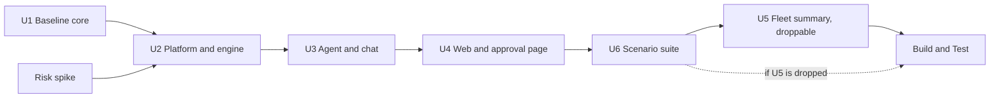

# Unit of Work Dependencies: itops-console

**Stage**: INCEPTION - Units Generation
**Created**: 2026-11-24
**Companion to**: `unit-of-work.md`, `component-dependency.md`

---

## Dependency matrix

Read across: the row unit depends on the column unit (imports its modules or
reuses its test support).

| Row depends on column | U1 Core | U2 Platform and engine | U3 Agent and chat | U4 Web and approval | U5 Fleet | U6 Scenarios |
|---|---|---|---|---|---|---|
| **U1** Baseline core | - | no | no | no | no | no |
| **U2** Platform and engine | yes: core types, `score_device` | - | no | no | no | no |
| **U3** Agent and chat | yes: core types in prompts and the session | yes: clients, act guard, scoring, events, settings, fakes | - | no | no | no |
| **U4** Web and approval | no | yes: approval store, events, transcript reader, settings, fakes | no | - | no | no |
| **U5** Fleet summary | yes: core types | yes: scoring service, read client, events | yes: LLM client, prompts | yes: app factory, security, base templates | - | no |
| **U6** Scenario suite | no | yes: `main.build`, fakes | yes: chat session, agent, scripted fake model | no | no | - |

The matrix is acyclic. Nothing depends on U5 or U6, so U5 can be dropped and
U6 can run last without changing any other unit. U4 does not depend on U3:
the approval link reaches the terminal as an event (U2), which U3's printer
prints.

### Additive extension points

| Module | Created by | Extended by | Extension |
|---|---|---|---|
| `main.py` | U2 | U3, U4, U5 | Each unit adds the construction and wiring of its own components |
| `scoring.py` | U2 | U5 | `score_fleet` and the `CatalogSource` parameter |
| `app.py` | U4 | U5 | `/fleet` and `/fleet/narrative` routes |
| `tests/support/` | U1 | U2, U3 | U1: Hypothesis domain strategies; U2: fake MCP servers, recorded responses, scripted fake model; U3: agent-specific scripts |
| `tests/architecture/` | U1 | U2, U3, U4 | Each unit adds the boundary rules for its modules (B1 and B9 in U1; B2, B3, B6, B8 in U2; B2, B4, B5, B7 in U3; B3 completed in U4) |

A later unit may add to these modules but may not change behavior an earlier
unit's tests pin. If a later unit needs such a change, it is raised as a
change to the earlier unit's design.

---

## Build order (Q2 = A)

| Step | Work | Gate |
|---|---|---|
| 0 | U1 Functional Design (no code) may start right away | None |
| 1 | Risk spike (below) | Stakeholder gate (code) |
| 2 | U1 Code Generation | Stakeholder gate |
| 3 | U2: design, then code | U1 approved; spike results recorded |
| 4 | U3: design, then code | U2 approved |
| 5 | U4: design, then code | U2 approved (U3 recommended first, per the stakeholder's read-only-first advice) |
| 6 | U6: design, then code; scenarios approved by the user | U3 approved |
| 7 | U5: design, then code, if time allows | U4 approved; otherwise dropped under FR-FLT-6 |
| 8 | Build and Test: live engine in demo mode, timed setup run, scenario-suite runs | All built units approved |

This order follows the stakeholder's advice: what a person can do grows from
read-only (U1 to U3: identify, score, explain, plan) to human-approved action
(U4), and every remediation runs on the engine's no-op demo runner
(FR-REM-3).



Text alternative:

```
U1 Baseline core ----------+
                           +--> U2 Platform and engine --> U3 Agent and chat
Risk spike ----------------+
U3 --> U4 Web and approval page --> U6 Scenario suite --> U5 Fleet summary
U5 --> Build and Test
If U5 is dropped: U6 --> Build and Test
```

---

## Integration approach (Q3 = A)

- **Inside the console**, units integrate through the interfaces in
  `component-methods.md` and are wired only in `main.py` (Q8 = A). Each unit's
  tests build what they need with fakes from `tests/support/`.
- **With the engine**, every unit tests against recorded responses and the
  in-process fake read and act MCP servers from U2. The act fake records every
  execution, so approval-safety tests count executions directly, and it can be
  told to misbehave (execute without an accepted answer, send an unexpected
  elicitation, name a real runner) for the act guard's tests (MS-7).
- **With the model**, U3 and U6 test against a scripted fake model; no unit
  test calls the gateway.
- **Live integration** with the engine's demo mode and the gateway happens
  once, in Build and Test, after the engine's demo mode exists (engine work is
  outside this workflow, Q14 = A).

## Risk spike (Q4 = A)

Runs at the start of Construction, before U2's Functional Design. It is code,
so it waits for the stakeholder gate. U1's Functional Design can proceed
meanwhile.

| Spike | Question | Done when |
|---|---|---|
| S-1 Elicitation | Can a fastmcp 4 client negotiate MCP revision 2026-07-28 with the engine's act server, receive the approval form elicitation, hold it open while awaiting an `asyncio.Future` for at least a few minutes, then answer accept, decline or cancel? | A throwaway script does all of this against the engine's approval test setup, and the handler's signature and answer type are written down (open item 5) |
| S-2 Gateway tool calling | Does a tool call round-trip work through the gateway with `claude-opus-5-5` and `claude-sonnet-5-5` using the `openai` client and `base_url`? | A throwaway script sends one tool definition, receives a tool call, returns a result and gets a final answer from each model |

- Scripts live in `spikes/` at the repository root, outside the
  `itops_console/` package; nothing imports them, and they hold no secrets
  (the key comes from `.env`).
- Results go in `aidlc-docs/construction/spikes/spike-results.md`, including
  anything that changes U2 or U3's design.
- If S-1 fails, U2's Functional Design must choose a fallback before code
  (for example a thin elicitation shim over the MCP client session); if S-2
  fails, U3's must. Either is raised with the user, not decided silently.

## Shared resources and conflicts

| Resource | Owner | Conflict rule |
|---|---|---|
| The event kinds list in `events.py` | U2 | Later units add kinds; none is renamed or removed |
| Transcript record format | U2 | Additive fields only, so older transcripts stay readable (round-trip property) |
| `.env.example` and `Settings` | U2 | Later units add variables with documented defaults |
| Policy file schema | U1 | U5 does not change it if the catalog comes from the engine (open item 2) |
| Engine contract (requirements section 6) | Engine repository | Changes arrive through the evidence adapter (C8) and recorded responses only |
