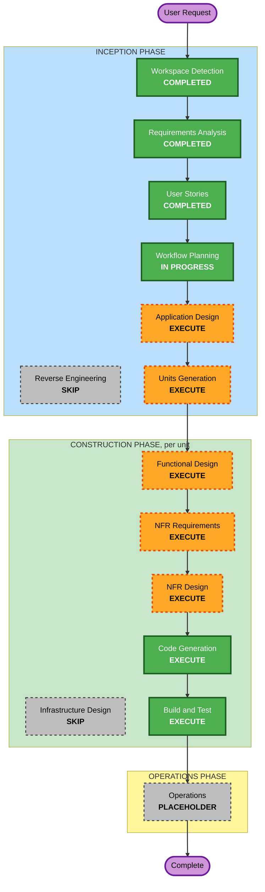

# Execution Plan

**Stage**: INCEPTION - Workflow Planning
**Created**: 2026-11-19
**Inputs**: `requirements.md`, `requirement-verification-questions.md`,
`stories.md`, `personas.md`

## Detailed Analysis Summary

### Change Impact Assessment
- **User-facing changes**: Yes. A new product with four surfaces: terminal chat, approval page, fleet summary page and transcript viewer (30 user stories).
- **Structural changes**: Yes. A new architecture: one async Python process holding the rule engine, agent loop, MCP clients, approval store, transcript writer and web app.
- **Data model changes**: Yes. New evidence, result, policy, approval and transcript models; no database (JSON Lines and YAML).
- **API changes**: Yes. New local web routes, and a consumer contract on the itops-mcp read and act servers (requirements section 6).
- **NFR impact**: Yes. The Security Baseline is enabled (15 security requirements), property-based testing is Partial, and there are accessibility, coverage and setup-time targets.

### Risk Assessment
- **Risk Level**: High. The approval boundary is safety-critical; the engine contract, gateway tool calling and fastmcp elicitation support are unverified; one developer has about three weeks.
- **Rollback Complexity**: Easy. Greenfield and local only; nothing is deployed.
- **Testing Complexity**: Complex. Pure rule tests with boundaries and properties, a scripted fake model, recorded MCP responses, a fake act server for approval safety, web security tests, and a model-based scenario suite.

### External dependency (not a unit of this workflow)
The itops-mcp engine work (CrashPlan, TDX and K2 connectors, the normalized
evidence tool, the fixture fleet, demo mode) is tracked in the engine
repository (Q14 = A). Every console unit tests against recorded responses or
fakes, so no unit is blocked by it. Live integration happens in Build and Test
once the engine's demo mode exists.

### Stakeholder guidance (call of 2026-11-18)
The stakeholder advised starting read-only and non-dangerous. The plan keeps
the approval path in the MVP because it is the product's reason to exist, but
it runs only on the engine's no-op demo runner (FR-REM-3) and is enforced at
both the server and the console (FR-APR-8). No stage changes as a result;
Application Design must place FR-APR-8's two layers in separate modules.

### Gate before code
Code Generation Part 2 for any unit starts only after the user confirms the
stakeholder check-in (aidlc-state.md, Session Notes).

## Workflow Visualization



### Text alternative

```
INCEPTION
- Workspace Detection ........ COMPLETED
- Reverse Engineering ........ SKIPPED (greenfield)
- Requirements Analysis ...... COMPLETED
- User Stories ............... COMPLETED
- Workflow Planning .......... IN PROGRESS
- Application Design ......... EXECUTE
- Units Generation ........... EXECUTE
CONSTRUCTION (repeated per unit)
- Functional Design .......... EXECUTE (depth varies by unit)
- NFR Requirements ........... EXECUTE (light)
- NFR Design ................. EXECUTE
- Infrastructure Design ...... SKIP
- Code Generation ............ EXECUTE (Part 2 gated on stakeholder check-in)
- Build and Test ............. EXECUTE (after all units)
OPERATIONS
- Operations ................. PLACEHOLDER
```

## Phases to Execute

### 🔵 INCEPTION PHASE
- [x] Workspace Detection (COMPLETED 2026-11-17)
- [x] Reverse Engineering (SKIPPED: greenfield)
- [x] Requirements Analysis (COMPLETED 2026-11-19)
- [x] User Stories (COMPLETED 2026-11-19)
- [x] Execution Plan (IN PROGRESS)
- [ ] Application Design - EXECUTE
  - **Rationale**: Every component is new. Interfaces need defining before code: the rule engine's evidence and result types, the approval store (the only path that answers an elicitation), the MCP client wrappers against the engine contract, the agent loop's tool and limit interface, the transcript record format, and the web security layer (session, origin, CSRF, headers). SECURITY-11 asks for security-critical logic in dedicated modules, which is a design decision.
- [ ] Units Generation - EXECUTE
  - **Rationale**: Three weeks for one developer needs an explicit build order, and the fleet summary must be droppable without touching anything else. Likely units (to be decided in that stage): baseline core (policy, rules, fleet computation); engine integration (MCP clients, approvals, transcript); agent and terminal chat; web (approval page, fleet page, transcript viewer, security); scenario suite.

### 🟢 CONSTRUCTION PHASE
- [ ] Functional Design - EXECUTE (per unit, depth varies)
  - **Rationale**: The baseline core has the most business logic in the product (seven checks, advisories, unreliable sources, certification states, fleet rankings) and needs full design, including the testable-properties section (PBT-01). The approval state machine needs exact states and transitions. Units with little logic (scenario suite) get a minimal design.
- [ ] NFR Requirements - EXECUTE (light)
  - **Rationale**: The stack is fixed by `tech-env.md`, but the Security Baseline and Partial PBT add choices to record: Hypothesis (PBT-09), the SBOM tool (SECURITY-10), log rotation and retention (SECURITY-14), and whether `Secure` cookies work on `127.0.0.1` in the target browsers (SEC-REQ-2).
- [ ] NFR Design - EXECUTE
  - **Rationale**: Turns the security requirements into patterns: launch-token session middleware, origin and CSRF checks, security headers and CSP compatible with HTMX, generic error handling that fails closed, structured logging with redaction, and security-event alerts in the terminal.
- [ ] Infrastructure Design - SKIP
  - **Rationale**: Local only, with no cloud resources (`tech-env.md`). The engine's containers belong to the engine repository. The CI workflow is a file in this repository and is produced in Code Generation.
- [ ] Code Generation - EXECUTE (ALWAYS)
  - **Rationale**: Implementation planning and code generation needed. Part 2 is gated on the stakeholder check-in.
- [ ] Build and Test - EXECUTE (ALWAYS)
  - **Rationale**: Build, test and verification needed, including live integration with the engine's demo mode, the timed setup run and the scenario suite.

### 🟡 OPERATIONS PHASE
- [ ] Operations - PLACEHOLDER
  - **Rationale**: Future deployment and monitoring workflows.

## Estimated Timeline
- **Total stages remaining**: 2 inception stages, then 4 construction stages per unit, then Build and Test
- **Estimated duration**: design stages in the coming sessions; construction in about three weeks of build time (vision), starting after the stakeholder check-in

## Success Criteria
- **Primary goal**: A local console that scores a device deterministically, explains the result with evidence, and runs a catalog fix only after a person approves the full plan.
- **Key deliverables**: the console package, the policy example, tests (unit, property, agent, MCP, approval safety, web), the scenario suite with committed results, README, CI workflow.
- **Quality gates**: the success metrics in requirements section 4.1; CI gates from `tech-env.md`; Security Baseline compliance at every stage; PBT rules 02, 03, 07, 08 and 09.

## Extension compliance (this stage)
- **Security Baseline**: no artifacts with security controls produced in this stage; all rules N/A here. The plan includes NFR Requirements and NFR Design so the security requirements get designed. No blocking findings.
- **Property-Based Testing (Partial)**: N/A at this stage. Functional Design is included so properties can be identified.
- **Resiliency Baseline**: disabled (Q30 = B); skipped.
